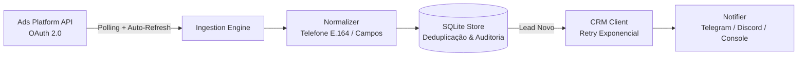

# Ads-to-CRM Lead Pipeline

Pipeline assíncrono/agendável em Python para captura contínua de leads de plataformas de mídia paga (API REST com OAuth 2.0), normalização/deduplicação em SQLite, injeção automática em CRM e disparo de alertas operacionais via Webhook/Telegram.

> **100% demonstrável localmente:** inclui modo `--demo` com simulador em memória de Ads API, CRM e Webhook para testar todo o fluxo sem precisar de chaves ou credenciais externas.

## Arquitetura



## Principais Recursos

- **OAuth 2.0 Resiliente:** detecção automática de `401 Unauthorized`, renovação via `refresh_token` e persistência atômica das credenciais.
- **Deduplicação Idempotente:** armazenamento em SQLite garantindo que o mesmo `lead_id` nunca gere negócio duplicado no CRM.
- **Normalização de Dados:** padronização de telefones brasileiros/internacionais para E.164 (`+55...`) e mapeamento flexível de perguntas de formulários.
- **Tolerância a Falhas:** retentativas com backoff exponencial para instabilidades temporárias de rede (`429` / `5xx`).
- **Filtro por Formulários Autorizados:** processa apenas campanhas/formulários configurados em `config.example.json`.

## Como Executar (Modo Demonstração)

```bash
python -m venv .venv
.venv\Scripts\activate  # Linux/Mac: source .venv/bin/activate
pip install -r requirements.txt

# Roda um ciclo completo com dados sintéticos (sem credenciais reais)
python -m src.cli --demo

# Roda os testes automatizados
pytest -v
```

## Configuração para Produção

1. Copie `.env.example` para `.env` e preencha suas credenciais.
2. Copie `config.example.json` para `config.json` e informe os IDs das contas e formulários autorizados.
3. Execute `python -m src.cli` (ou agende via `cron` / Task Scheduler).

## Estrutura do Projeto

```text
ads-crm-lead-pipeline/
├── src/
│   ├── __init__.py
│   ├── cli.py          # Ponto de entrada (produção e --demo)
│   ├── config.py       # Carregamento validado de .env e config.json
│   ├── normalizer.py   # Padronização de telefones, e-mails e payload
│   ├── oauth.py        # Gerenciador OAuth 2.0 com renovação automática
│   ├── pipeline.py     # Orquestração, deduplicação e retry
│   ├── providers.py    # Adaptadores REST (real + simulador demo)
│   └── storage.py      # Persistência SQLite (idempotência e histórico)
├── tests/
│   └── test_pipeline.py
├── .env.example
├── .gitignore
├── config.example.json
└── requirements.txt
```
